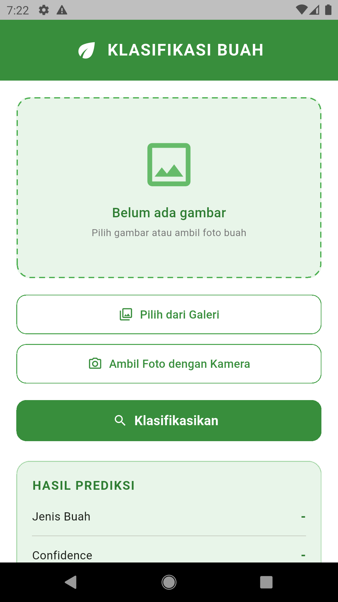
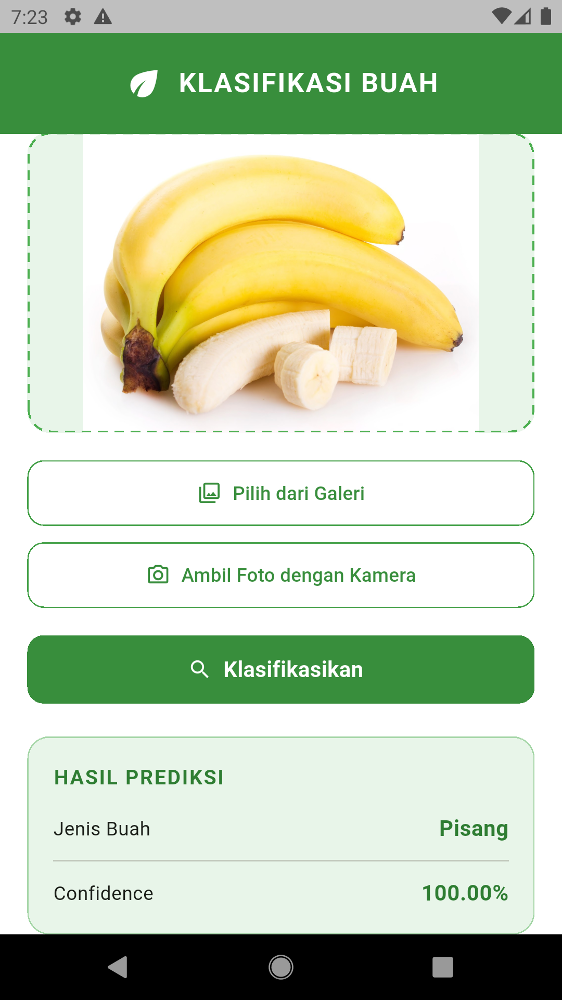

# Aplikasi Klasifikasi Buah

Aplikasi mobile untuk klasifikasi foto/gambar buah menggunakan model *Machine Learning*. Model klasifikasi dibuat dengan Google Teachable Machine, kemudian diintegrasikan ke aplikasi menggunakan TensorFlow Lite.

## Screenshot Aplikasi

<table>
  <tr>
    <td align="center">
      <strong>Tampilan Utama</strong>
    </td>
    <td align="center">
      <strong>Klasifikasi Buah</strong>
    </td>
  </tr>
  <tr>
    <td align="center">
      
    </td>
    <td align="center">
      
    </td>
  </tr>
</table>

## Fitur

- Memilih gambar buah dari galeri.
- Mengambil gambar secara langsung menggunakan kamera.
- Menampilkan pratinjau gambar.
- Mengidentifikasi jenis buah menggunakan model TensorFlow Lite.
- Menampilkan hasil klasifikasi dan nilai confidence.
- Menjalankan proses klasifikasi secara lokal pada perangkat.

## Kelas Klasifikasi

Aplikasi mengenali empat jenis buah:

| No. | Nama Buah | Label |
|---|---|---|
| 1 | Pisang | `Pisang` |
| 2 | Jeruk | `Jeruk` |
| 3 | Mangga | `Mangga` |
| 4 | Apel | `Apel` |

## Teknologi dan Package

- Flutter dan Dart
- TensorFlow Lite
- Google Teachable Machine
- `tflite_flutter: ^0.12.1`
- `image_picker: ^1.2.4`
- `image: ^4.13.1`

## Model Klasifikasi

Model dibuat dan dilatih menggunakan Google Teachable Machine, kemudian diekspor ke format TensorFlow Lite agar dapat dijalankan pada perangkat Android.

File model dan label disimpan dalam direktori:

```text
assets/model/
├── model_unquant.tflite
└── labels.txt
```

Spesifikasi input dan output model:

| Komponen | Bentuk |
|---|---|
| Input tensor | `float32[1, 224, 224, 3]` |
| Output tensor | `float32[1, 4]` |
| Ukuran gambar input | 224 × 224 piksel |
| Channel | RGB |
| Jumlah kelas | 4 |

Sebelum diklasifikasikan, gambar diproses agar sesuai dengan format input model. TensorFlow Lite kemudian menghasilkan nilai prediksi untuk masing-masing kelas buah. Kelas dengan nilai prediksi tertinggi digunakan sebagai hasil klasifikasi.

## Struktur Project

```text
flutter-klasifikasi-buah/
├── assets/
│   └── model/
│       ├── model_unquant.tflite
│       └── labels.txt
├── lib/
│   ├── main.dart
│   ├── screens/
│   │   └── home_screen.dart
│   ├── services/
│   │   └── classifier_service.dart
│   └── widgets/
│       ├── image_preview.dart
│       ├── image_picker_buttons.dart
│       └── prediction_result.dart
├── screenshots/
│   ├── screenshot001.png
│   └── screenshot002.png
├── pubspec.yaml
└── pubspec.lock
```

## Menjalankan Aplikasi

Pastikan Flutter SDK dan perangkat Android atau emulator sudah tersedia.

Clone repository:

```bash
git clone https://github.com/uqifumi/flutter-klasifikasi-buah.git
```

Masuk ke direktori project:

```bash
cd flutter-klasifikasi-buah
```

Unduh dependensi:

```bash
flutter pub get
```

Jalankan aplikasi:

```bash
flutter run
```

## Lisensi

Project ini dikembangkan untuk tujuan pembelajaran dan pengembangan aplikasi mobile berbasis Machine Learning.
